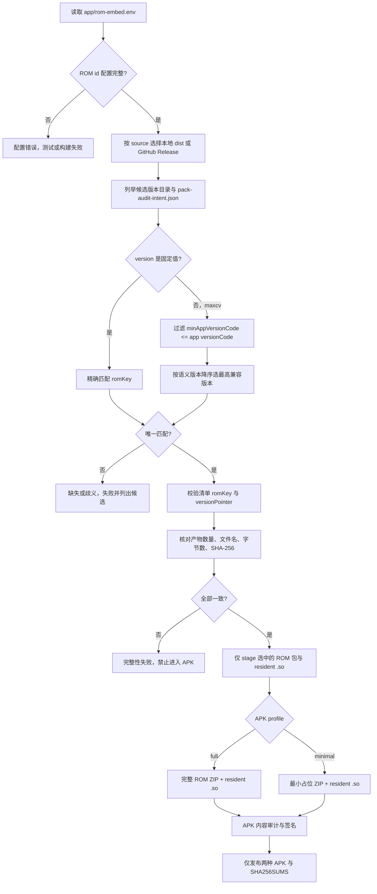

# ROM 拉取流程

图中每条配置只处理一个 ROM id。固定版本和 `maxcv` 在解析阶段变成唯一 `romKey`，之后本地 dist 与远程 Release 走同一套清单验证和 staging。

远程与本地只在候选产物的读取位置不同。版本选择、清单验证和失败策略保持一致，因此本地来源不会因为信任工作区而跳过哈希校验。下载失败、版本不存在、兼容版本为空、重复 `romKey`、文件计数不一致或哈希不匹配都会阻断 Release 构建。

流程图描述目标契约，不代表尚未验证的阶段已经在 GitHub Actions 实测通过；实现进度见 [06-IMPLEMENTATION-STATUS.md](06-IMPLEMENTATION-STATUS.md)。
